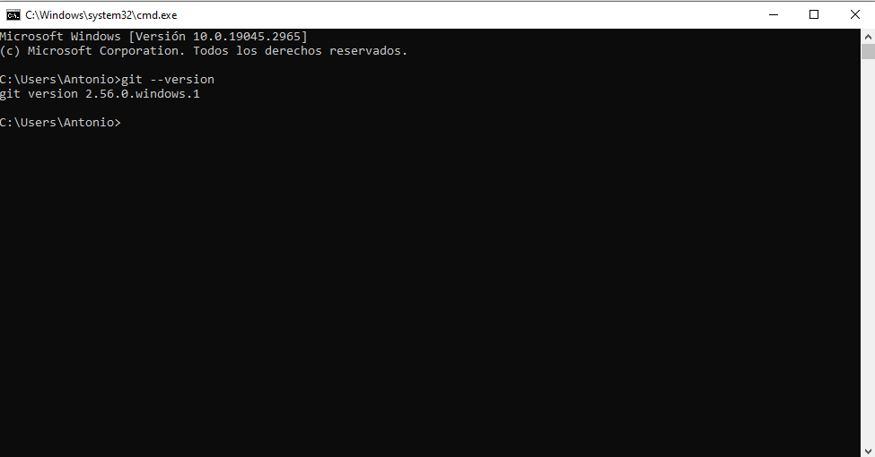
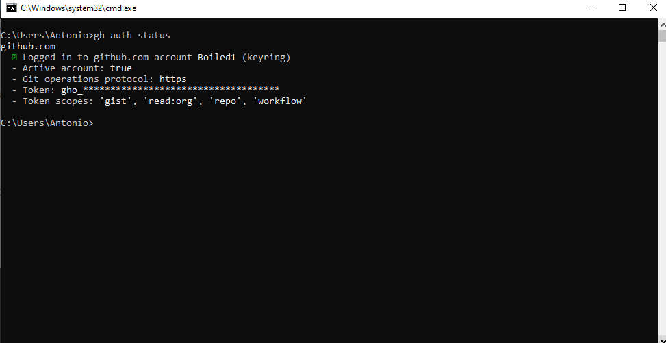
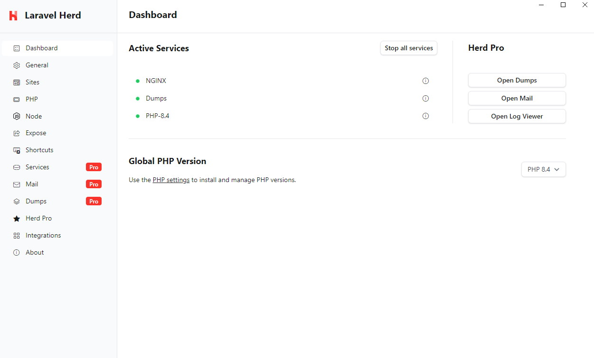
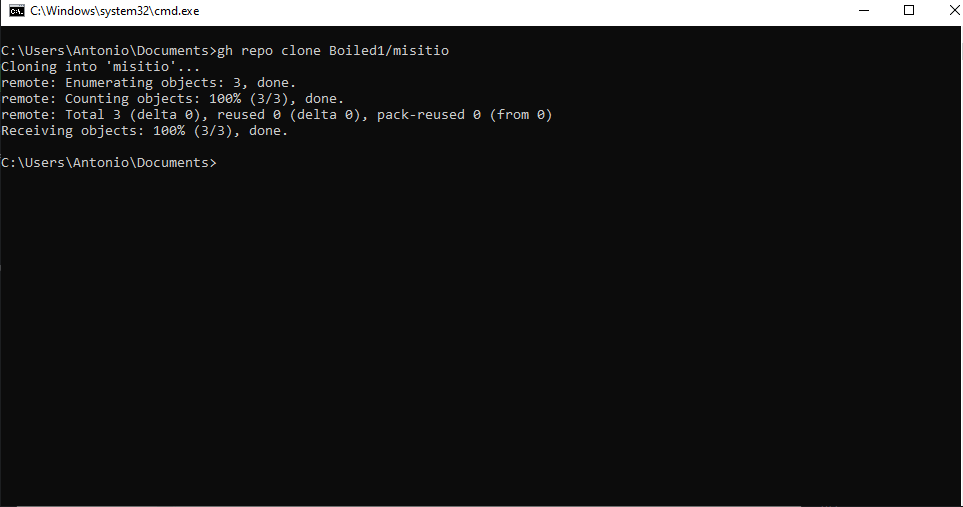
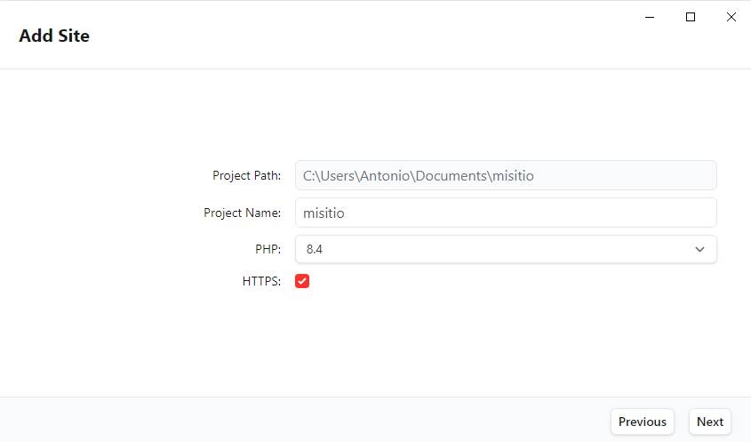

## 1. Git instalado y configurado en local
En este paso se muestra que Git está instalado y configurado en el equipo local lo cual compruebo mediante el comando "git --version"

## 2. GitHub CLI instalado y configurado
Seguidamente en este paso se muestra que GitHub CLI está instalado y configurado en el equipo local lo cual compruebo mediante el comando "gh --version"

## 3. Herd instalado con la versión de PHP 8.4
A continuacion instalaremos Herd con la versión de PHP 8.4, este paso es el mas facil hasta ahora ya que solo hay que ejecutar un instalador de windows y esperar

## 4. Repositorio "misitio" clonado en local
Aqui clonamos el repositorio "misitio" mediante el comando "gh repo clone" acompañado del nombre de usuario de github y el nombre del repositorio, en este caso "misitio"

## 5. Herd enlazado al repositorio "misitio" y sirviéndolo en  HTTPS
Por ultimo enlazamos Herd al repositorio "misitio" mediante la interfaz grafica del programa y habilitamos el tick en el apartado HTTPS

### En cuanto a la parte de los plugins y elementos usados de "ReadtheDocs" no he utilizado ninguno asi que no tengo nada al respecto que destacar sobre los mismos